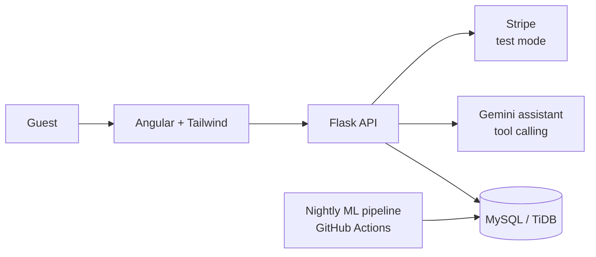

<div align="center">

# Hajz · حجز

**Find the stay that fits you, not just the one that's available.**

An AI-powered stay booking platform built on real listings from 14 cities around the world.

*Hajz (حجز) means "booking" in Arabic.*

</div>

---

## Mission

Make choosing a place to stay feel like asking a well-travelled friend.
Hajz learns what each guest values, explains why it recommends a stay, and lets
people describe their trip in plain language instead of fighting filters.

## Vision

A booking experience where every recommendation is **personal, explainable and
trustworthy**: built on real data, honest about its limits, and engineered to the
standard of production software.

## Why Hajz is different

| | Feature | What it means for the guest |
|---|---|---|
| 🤖 | **AI travel assistant** | "2 adults, Tokyo, quiet, near the metro, under $150" → real stays you can book, with the reasons it picked them |
| 🎯 | **Hybrid recommendations** | "Similar stays", "Guests also stayed at" and "For you", built from real guest behaviour and listing content |
| 💬 | **"Why this?"** | Every recommendation explains itself, e.g. *"Because you saved two quiet apartments near the metro"* |
| 🔎 | **Search by meaning** | "Cozy place for remote work" finds the right stays even without those exact words |
| 🌍 | **Your taste, any city** | Liked a stay in Bangkok? Hajz finds its closest match in Tokyo |
| 🔒 | **No double bookings** | The database itself guarantees two guests can never book the same night |
| 🗺️ | **Map search** | Browse 14 cities on an interactive map |

**Try it in 30 seconds:** one-click demo personas (Budget Backpacker, Luxury Couple,
Remote Worker, Family Traveller) show the recommendations and assistant adapting to
different travellers.

**Live:** https://hajz-booking.vercel.app (early preview; the API sleeps when idle, so the first load can take up to a minute)

## Cities

Tokyo · Bangkok · Singapore · Taipei · Istanbul · London · Paris · Barcelona · Rome ·
New York City · Mexico City · Rio de Janeiro · Cape Town · Sydney

## How it works



- The **assistant** can only answer from Hajz's own data: it calls search and
  availability tools, so it never invents a hotel.
- **Recommendations** are computed nightly (embeddings + collaborative filtering +
  diversity re-ranking) and served instantly from the database.
- **Bookings** hold dates for 10 minutes, confirm on payment, and follow clear
  cancellation and refund policies.

## Engineering highlights

- **Planned like real software:** planning → design → build, with every business rule
  given an ID (e.g. `BR-BKG-11`) that the code, tests and error codes point back to.
- **Integrity in the database:** `CHECK` constraints and a one-row-per-night table
  make invalid bookings impossible, not just unlikely.
- **Versioned schema:** numbered Alembic migrations with rollback, plus a check that
  fails if the code and database drift apart.
- **Built to run free and stay up:** Docker, environment-based config and portable
  hosting.

## Tech stack

| Layer | Technology |
|---|---|
| Frontend | Angular, Tailwind CSS, Leaflet (OpenStreetMap) |
| Backend | Python 3.13, Flask, SQLAlchemy 2, Alembic, Marshmallow |
| Database | MySQL 8 (local, Docker) · TiDB Cloud Serverless (production) |
| ML | scikit-learn, embeddings, offline batch pipeline |
| AI | Gemini with tool calling |
| Payments | Stripe (test mode only) |
| Hosting & CI/CD | Vercel · Render · GitHub Actions |

## Roadmap

| Milestone | Status |
|---|---|
| Planning and design | ✅ Done |
| Database layer (25 tables, migrations, seeders) | ✅ Done |
| M0 · Setup: API, frontend, CI, live on Vercel + Render + TiDB | ✅ Done |
| M1 · Data import (14 cities) | ⏳ Next |
| M2 · Catalogue, search and map | ⬜ |
| M3 · Accounts and demo personas | ⬜ |
| M4 · Booking and Stripe test payments | ⬜ |
| M5 · Recommender | ⬜ |
| M6 · AI assistant | ⬜ |
| M7 · Polish, monitoring, demo video | ⬜ |

## Documentation

| Document | Contents |
|---|---|
| [01 Planning](docs/01-planning.md) | Vision, scope, requirements, milestones |
| [02 Architecture](docs/02-architecture.md) | System design, key flows, security |
| [03 Data model](docs/03-data-model.md) | Tables, relationships, sizing |
| [04 Business rules](docs/04-business-rules.md) | Booking, pricing, cancellation and other rules |
| [05 Design reference](docs/05-design-reference.md) | Colours, type, components the UI is based on |
| [06 Local development](docs/06-local-development.md) | Run the frontend and backend, tests, troubleshooting |
| [07 Deployment](docs/07-deployment.md) | TiDB Cloud, Render and Vercel setup |

## Run locally

Requirements: Docker Desktop, Python 3.13 and Node.js 24. Full guide with
first-time setup, tests and troubleshooting:
**[06 Local development](docs/06-local-development.md)**.

After first-time setup, run in two terminals:

```powershell
# Terminal 1: database + API on http://localhost:8000
docker compose up -d
cd backend
.\.venv\Scripts\Activate.ps1
python app.py
```

```powershell
# Terminal 2: frontend on http://localhost:4302
cd frontend
npm start
```

## Data and honesty

- Listings come from [Inside Airbnb](https://insideairbnb.com/), licensed under
  [CC BY 4.0](https://creativecommons.org/licenses/by/4.0/). Hajz is not affiliated with Airbnb.
- Photos are licensed images matched by city and room type, not photos of the actual properties.
- Some values the dataset lacks (cancellation policy, cleaning fee) are generated by
  documented rules (see `BR-IMP` in the business rules).
- Payments run in Stripe **test mode**. No real money is ever charged.

## Author

Built by **[Nasser Aldahmashi](https://github.com/aldahmashi)**.
