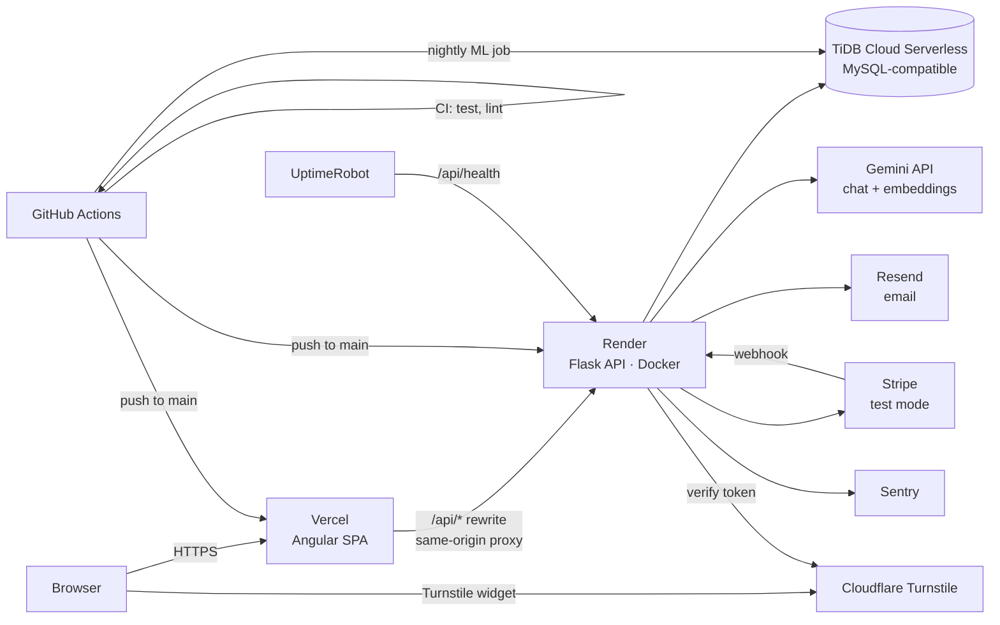
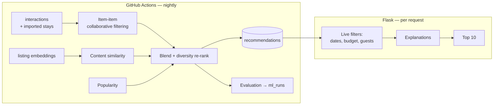

# Hajz — System Architecture

| | |
|---|---|
| Version | 0.1 (draft for review) |
| Depends on | [01-planning.md](01-planning.md) |

## 1. Overview



Three runtime pieces, all free tier:

| Component | Host | Responsibility |
|---|---|---|
| Frontend | Vercel | Angular SPA styled with Tailwind CSS, `/api/*` proxy to backend |
| Backend | Render (Docker) | REST API, auth, booking engine, recommendation serving, AI assistant |
| Database | TiDB Cloud Serverless | All persistent state |
| ML pipeline | GitHub Actions (cron) | Embeddings, recommender training, evaluation, cleanup |

## 2. Repository layout (monorepo)

```text
hajz/
├── backend/                Flask API (from the CTI foundation)
│   ├── app.py, config.py, db.py
│   ├── routes/ controllers/ services/ models/ validations/ middlewares/ helpers/
│   ├── migrations/         Alembic (numbered raw-SQL migrations, RMC style)
│   ├── database/seeders/   Python seeders (RMC style)
│   ├── manage.py           migrate, rollback, seed, reset-db, db-status
│   ├── tests/              pytest
│   └── Dockerfile
├── frontend/               Angular app
├── ml/                     Offline pipeline (not deployed to Render)
│   ├── ingest/             Inside Airbnb download, clean, import
│   ├── photos/             Pexels / Unsplash assignment
│   ├── embeddings/         Listing embeddings
│   ├── recommender/        Training, scoring, evaluation
│   └── jobs/nightly.py     Entry point for the scheduled job
├── data/                   Raw CSVs (git-ignored)
├── docs/                   Planning, design, runbooks, ADRs
├── docker-compose.yml      Local MySQL 8 + backend
├── render.yaml             Render blueprint
└── .github/workflows/      ci.yml, nightly-ml.yml
```

`ml/` is a separate Python package with heavier dependencies (pandas, scipy,
scikit-learn). The backend never imports it, so the Render image stays small.

## 3. Backend design

Layering is kept from the CTI foundation:

```text
routes → controllers → services → repositories/models → db
              ↑             ↑
        validations    helpers (errors, response, logger, pagination)
        middlewares (auth, rate limit)
```

### Modules

| Module | Responsibility |
|---|---|
| `auth` | Register, verify, login, refresh, logout, reset, demo login, delete account |
| `catalog` | Cities, listing search, listing details, availability, map bounds |
| `search` | Semantic search (query embedding + cosine over in-memory matrix) |
| `booking` | Quote, hold, confirm, cancel, my trips, policy engine |
| `payments` | Stripe PaymentIntents, webhook handling, idempotency |
| `wishlist` | Save / unsave |
| `reviews` | Create after completed stay; list |
| `recommendations` | Read precomputed results, apply live filters, explanations |
| `interactions` | Record view / save / book events |
| `assistant` | Gemini chat with tool calling, quotas, fallback |
| `admin` | Metrics, users, ML runs |
| `fx` | Currency conversion for display |

### Changes from the CTI foundation

| Foundation part | Hajz |
|---|---|
| APU Microsoft auth (`helpers/auth.py`) | Own JWT auth (argon2 passwords, access + refresh tokens) |
| DingDong email | Resend |
| AWS Secrets Manager config | Plain env vars (Render dashboard) |
| Zappa / Bitbucket | Docker on Render / GitHub Actions |
| Commit in `teardown_appcontext` | Explicit commit in services before the response is built |
| SQL file runner | Alembic migrations + Python seeders, following the RMC backend |
| S3 uploads | Not needed in core (photos are external URLs) |

## 4. Key flows

### 4.1 Authentication

- **Access token:** JWT, 15 minutes, held in memory by the Angular app, sent as `Authorization: Bearer`.
- **Refresh token:** random 256-bit value, stored **hashed** in `refresh_tokens`, delivered as an `HttpOnly; Secure; SameSite=Lax` cookie scoped to `/api/auth`. Rotated on every refresh; reuse of a revoked token revokes the whole family.
- **Same-origin:** the SPA calls `/api/*` on its own Vercel domain; Vercel rewrites to Render. Cookies are therefore first-party and survive third-party-cookie blocking.
  - *Verify in M0:* proxy timeout during Render cold start. Fallback: a custom domain with `api.` subdomain.

### 4.2 Booking (no double booking)

```mermaid
sequenceDiagram
    participant A as Angular
    participant API as Flask
    participant DB as TiDB
    participant S as Stripe
    A->>API: POST /bookings/quote
    API-->>A: price breakdown
    A->>API: POST /bookings (hold)
    API->>DB: BEGIN; SELECT listing FOR UPDATE
    API->>DB: release expired holds on this listing
    API->>DB: INSERT booking (status=held, expires +10 min)
    API->>DB: INSERT booking_nights (one row per night)
    Note over DB: UNIQUE(listing_id, night) rejects overlaps
    API->>DB: COMMIT
    API->>S: create PaymentIntent (metadata: booking_id)
    API-->>A: booking + client_secret
    A->>S: confirm card (Stripe Elements)
    S->>API: webhook payment_intent.succeeded
    API->>DB: booking → confirmed (idempotent by event id)
    A->>API: GET /bookings/{id} (poll until confirmed)
```

- **Integrity is enforced by the database**, not only by application code: `booking_nights` has `UNIQUE(listing_id, night)`. Two concurrent holds for overlapping dates cannot both commit.
- **Hold expiry is lazy:** no always-on scheduler is needed (Render free tier sleeps). Expired holds are released inside the next hold transaction on that listing, ignored by availability queries (`status='held' AND hold_expires_at < now()`), and swept by the nightly job.
- **Webhooks:** verified by Stripe signature; processed once using `stripe_events.event_id` as an idempotency key. If Render is asleep, Stripe retries automatically.
- **Late payment:** if a payment succeeds after its hold expired and the nights were taken, the booking is marked `cancelled` and the PaymentIntent is refunded.

### 4.3 Recommendations



Detailed in `05-ml-ai-design.md`.

### 4.4 AI assistant

```text
User message
  → quota check (per user / IP, per day)
  → Gemini with tool declarations:
        search_stays · semantic_search · get_listing · check_availability · get_recommendations
  → tools execute against our services (never raw SQL from the model)
  → Gemini writes the reply, citing only returned listing IDs
  → API validates cited IDs exist, attaches listing cards
  → on Gemini error / quota: fallback to structured search with parsed filters
```

### 4.5 Semantic search

- Listing embeddings are computed offline (Gemini embedding model) and stored in `listing_embeddings`.
- On backend startup, embeddings for active listings are loaded into a NumPy matrix (~7,000 × 768 float32 ≈ 21 MB).
- A query is embedded with one Gemini call, then ranked by cosine similarity in memory.
- Fallback when Gemini is unavailable: keyword match on title, neighbourhood and amenities.

## 5. Environments

| Environment | Frontend | Backend | Database |
|---|---|---|---|
| Local | `ng serve` :4302 (proxy `/api` → :8000) | Flask :8000 | MySQL 8 in Docker |
| Preview | Vercel preview per pull request | Production API | Production DB (read-mostly) |
| Production | `hajz-booking.vercel.app` | `hajz-api.onrender.com` | TiDB Serverless |

## 6. CI/CD

| Workflow | Trigger | Steps |
|---|---|---|
| `ci.yml` | Push / pull request | Backend: ruff, pytest (MySQL service container). Frontend: lint, test, build |
| Render auto-deploy | Push to `main` after CI passes | Build Docker image, run Alembic migrations, start gunicorn |
| Vercel auto-deploy | Push to `main`; preview on PRs | Build Angular, deploy |
| `nightly-ml.yml` | Cron daily + manual | Sweep expired holds and junk data, rebuild recommendations, write evaluation |

## 7. Security

| Threat | Control |
|---|---|
| Credential stuffing / brute force | Rate limit on auth routes; argon2; generic error messages |
| Bot sign-ups | Turnstile on register and assistant |
| Token theft | Short access-token TTL; HttpOnly refresh cookie; rotation with reuse detection |
| CSRF on cookie routes | SameSite=Lax + refresh endpoint requires a custom header |
| Injection | SQLAlchemy parameterised queries; model tools call services, not SQL |
| Prompt injection via reviews | Review text is passed as quoted data; all assistant tools are read-only, so the model cannot book, pay or change data |
| Webhook spoofing | Stripe signature verification |
| Secret leakage | Env vars only; `.env` git-ignored; Gemini / Stripe secret keys never reach the browser |
| Abuse of AI quota | Per-user and per-IP daily limits; max tokens per reply |

## 8. Third-party services

| Service | Use | Free-tier risk |
|---|---|---|
| Render | Backend hosting | Sleeps when idle |
| Vercel | Frontend + proxy | Low |
| TiDB Cloud Serverless | Database | Usage caps |
| Gemini | Chat + embeddings | Rate limits; prompts may be used by Google on free tier |
| Stripe | Test payments | None (test mode) |
| Resend | Email | Daily send cap |
| Cloudflare Turnstile | Bot protection | Low |
| Pexels / Unsplash | Photos (assigned once) | None at runtime |
| Sentry | Error tracking | Event cap |
| UptimeRobot | Uptime monitor | Low |

Every service is accessed through a small adapter in `helpers/` so it can be
replaced without touching business logic.
