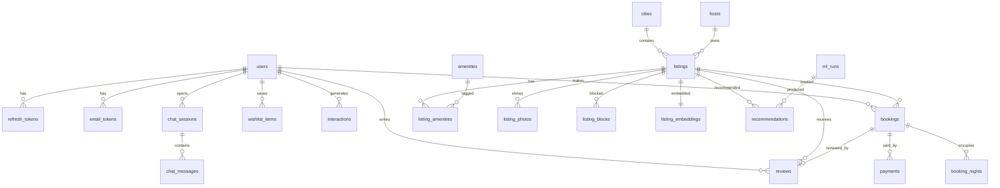

# Hajz — Data Model

| | |
|---|---|
| Version | 0.1 (draft for review) |
| Database | MySQL 8 (local) / TiDB Cloud Serverless (production) |
| Source of truth | `backend/migrations/versions/` (Alembic). This document explains the design. |
| Conventions | `snake_case`; `BIGINT` surrogate keys; UTC `DATETIME`; money stored as `DECIMAL(10,2)` in USD |

## 1. Entity-relationship diagram

## 2. Tables

### 2.1 Identity

**users**
| Column | Type | Notes |
|---|---|---|
| id | BIGINT PK | |
| email | VARCHAR(255) UNIQUE | Lower-cased |
| password_hash | VARCHAR(255) NULL | Argon2; NULL for demo personas |
| full_name | VARCHAR(120) | |
| role | ENUM('guest','admin') | |
| is_demo | BOOL | Demo persona |
| persona_key | VARCHAR(40) NULL UNIQUE | e.g. `budget_backpacker` |
| email_verified_at | DATETIME NULL | |
| preferred_currency | CHAR(3) | Default `USD` |
| created_at, updated_at | DATETIME | |
| deleted_at | DATETIME NULL | Soft delete, then anonymised |

**refresh_tokens** — `id, user_id FK, family_id, token_hash UNIQUE, expires_at, revoked_at NULL, replaced_by_id NULL, user_agent, ip_hash, created_at`

**email_tokens** — `id, user_id FK, purpose ENUM('verify','reset'), token_hash UNIQUE, expires_at, used_at NULL, created_at`

### 2.2 Catalogue

**cities**
| Column | Type | Notes |
|---|---|---|
| id | INT PK | |
| slug | VARCHAR(40) UNIQUE | `tokyo` |
| name, country, country_code | | |
| currency | CHAR(3) | Local currency of source prices |
| timezone | VARCHAR(40) | IANA, e.g. `Asia/Tokyo` |
| tax_rate | DECIMAL(5,4) | Simplified demo rate (BR-PRC-03) |
| lat, lng | DECIMAL(9,6) | Map centre |
| cover_photo_url, cover_photo_credit | | |
| snapshot_date | DATE | Inside Airbnb snapshot |

**hosts** — `id, source_host_id UNIQUE, name, is_superhost, host_since, response_rate, listings_count`

**listings**
| Column | Type | Notes |
|---|---|---|
| id | BIGINT PK | |
| source_listing_id | BIGINT UNIQUE | Inside Airbnb id |
| city_id | FK | Indexed |
| host_id | FK | |
| title | VARCHAR(255) | |
| description | TEXT | Cleaned HTML |
| neighbourhood | VARCHAR(120) | Indexed |
| lat, lng | DECIMAL(9,6) | Composite index for map bounds |
| property_type | VARCHAR(80) | |
| room_type | ENUM('entire_home','private_room','shared_room','hotel_room') | Indexed |
| accommodates, bedrooms, beds | SMALLINT | |
| bathrooms | DECIMAL(3,1) | |
| nightly_price_usd | DECIMAL(10,2) | Converted from source; indexed |
| nightly_price_local | DECIMAL(12,2) | Original |
| cleaning_fee_usd | DECIMAL(10,2) | Derived (source rarely includes it) |
| min_nights, max_nights | SMALLINT | |
| cancellation_policy | ENUM('flexible','moderate','strict') | |
| check_in_time, check_out_time | TIME | |
| rating_overall | DECIMAL(3,2) NULL | |
| rating_cleanliness, rating_location, rating_value, rating_communication | DECIMAL(3,2) NULL | |
| review_count | INT | |
| popularity_score | DECIMAL(8,4) | Precomputed (rating × log reviews) |
| is_active | BOOL | |
| created_at, updated_at | DATETIME | |

**amenities** — `id, name UNIQUE, category ENUM('essentials','kitchen','work','outdoor','safety','family','parking','other')`

**listing_amenities** — `listing_id, amenity_id` (composite PK)

**listing_photos** — `id, listing_id FK, url, thumb_url, width, height, alt_text, photographer, source ENUM('pexels','unsplash'), source_page_url, position`

### 2.3 Availability and booking

**listing_blocks** — dates the host blocked (from `calendar.csv`, stored as ranges).
| Column | Type | Notes |
|---|---|---|
| id | BIGINT PK | |
| listing_id | FK | |
| start_date | DATE | Inclusive |
| end_date | DATE | Exclusive |
| reason | ENUM('host','maintenance') | |

Index: `(listing_id, start_date, end_date)`.

**bookings**
| Column | Type | Notes |
|---|---|---|
| id | BIGINT PK | |
| code | CHAR(8) UNIQUE | Public reference, e.g. `HJZ4K9QX` |
| user_id, listing_id | FK | |
| check_in, check_out | DATE | Property-local dates; `check_out` exclusive |
| guests | SMALLINT | |
| status | ENUM('held','confirmed','completed','cancelled','expired') | Indexed with `hold_expires_at` |
| nights | SMALLINT | |
| nightly_usd, cleaning_usd, service_fee_usd, tax_usd, total_usd | DECIMAL(10,2) | Snapshot at quote time |
| display_currency | CHAR(3) | |
| fx_rate | DECIMAL(14,6) | USD → display currency at booking |
| cancellation_policy | ENUM | Snapshot |
| refund_usd | DECIMAL(10,2) NULL | |
| hold_expires_at | DATETIME NULL | |
| confirmed_at, cancelled_at, completed_at | DATETIME NULL | |
| cancel_reason | VARCHAR(255) NULL | |
| created_at, updated_at | DATETIME | |

**booking_nights** — the double-booking guard.
| Column | Type | Notes |
|---|---|---|
| listing_id | BIGINT | |
| night | DATE | One row per occupied night |
| booking_id | FK | |

`PRIMARY KEY (listing_id, night)` — two bookings can never hold the same night.
Rows are deleted when a booking is cancelled or expires.

**payments**
| Column | Type | Notes |
|---|---|---|
| id | BIGINT PK | |
| booking_id | FK | |
| provider | ENUM('stripe') | |
| provider_ref | VARCHAR(255) UNIQUE | PaymentIntent id |
| kind | ENUM('charge','refund') | |
| amount_usd | DECIMAL(10,2) | |
| status | ENUM('pending','succeeded','failed','refunded') | |
| created_at, updated_at | DATETIME | |

**stripe_events** — `event_id PK, type, received_at, processed_at NULL` (webhook idempotency)

### 2.4 Engagement

**wishlist_items** — `user_id, listing_id, created_at` (composite PK)

**reviews**
| Column | Type | Notes |
|---|---|---|
| id | BIGINT PK | |
| listing_id | FK | |
| source | ENUM('imported','app') | |
| booking_id | FK NULL UNIQUE | Set for app reviews: one per booking |
| user_id | FK NULL | App reviews |
| reviewer_name | VARCHAR(80) | First name only |
| rating | TINYINT NULL | 1–5; imported reviews have none |
| comment | TEXT | |
| created_at | DATETIME | |

Only the latest 30 imported reviews per listing are stored for display.

**interactions** — the recommender's training signal.
| Column | Type | Notes |
|---|---|---|
| id | BIGINT PK | |
| user_id | FK NULL | App users |
| source_reviewer_id | BIGINT NULL | Imported Inside Airbnb reviewer (pseudonymous) |
| listing_id | FK | |
| type | ENUM('view','save','book','review','imported_stay') | |
| weight | DECIMAL(4,2) | view 1, save 3, book 5, review 5, imported_stay 5 |
| occurred_at | DATETIME | |

Indexes: `(user_id, occurred_at)`, `(source_reviewer_id)`, `(listing_id)`.
Imported stays use **all** reviews (not only the 30 displayed).

### 2.5 Machine learning

**listing_embeddings** — `listing_id PK/FK, model VARCHAR(80), dim SMALLINT, vector BLOB (float32), text_hash CHAR(64), updated_at`

**recommendations**
| Column | Type | Notes |
|---|---|---|
| id | BIGINT PK | |
| run_id | FK → ml_runs | |
| subject_type | ENUM('listing','user') | |
| subject_id | BIGINT | Listing id or user id |
| kind | ENUM('similar','also_stayed','for_you','cross_city') | |
| listing_id | FK | Recommended listing |
| position | SMALLINT | Rank in the list (`rank` is reserved in MySQL 8) |
| score | DECIMAL(8,5) | |
| reason | JSON | e.g. `{"type":"similar_to_saved","listing_ids":[12,40]}` |

Index: `(subject_type, subject_id, kind, run_id)`. Each run writes a new set; the
API reads the latest successful `run_id`, and older runs are pruned.

**ml_runs** — `id, started_at, finished_at, status ENUM('running','succeeded','failed'), metrics JSON, git_sha, notes`

### 2.6 Assistant

**chat_sessions** — `id CHAR(26) PK (ULID), user_id FK NULL, anon_key_hash NULL, created_at, last_active_at`

**chat_messages** — `id, session_id FK, role ENUM('user','assistant','tool'), content TEXT, tool_name NULL, tool_payload JSON NULL, cited_listing_ids JSON NULL, tokens_in, tokens_out, created_at`

**ai_usage_daily** — `subject_key (user id or IP hash), day DATE, requests INT` (composite PK)

### 2.7 Reference

**fx_rates** — `currency CHAR(3) PK, usd_rate DECIMAL(14,6), as_of DATE`
(Fixed snapshot rates loaded with the data import; refreshed optionally by the nightly job.)

**listing_review_insights** *(phase 2)* — `listing_id PK, loves JSON, watch_outs JSON, summary TEXT, model, review_count_used, generated_at`

## 3. Sizing estimate

| Table | Rows (approx.) |
|---|---|
| listings | 7,000 |
| listing_photos | 28,000 |
| listing_amenities | 280,000 |
| listing_blocks | 60,000 |
| reviews (displayed) | 210,000 |
| interactions (imported) | 400,000–700,000 |
| recommendations | ~200,000 per run |
| listing_embeddings | 7,000 × 3 KB ≈ 21 MB |

Total well under 1 GB, comfortably inside free-tier limits.

## 4. Data rules

- All timestamps are stored in UTC. Booking dates are **property-local calendar dates**; the city's `timezone` converts "today" when validating check-in.
- Money is stored in USD with the source currency kept alongside; display conversion uses `fx_rates`.
- Personal data from Inside Airbnb is limited to reviewer first names and pseudonymous reviewer ids, as published in the CC BY 4.0 dataset.
- Deleting an account anonymises its reviews and bookings (kept for integrity) and deletes tokens, wishlist, interactions and chat history.
