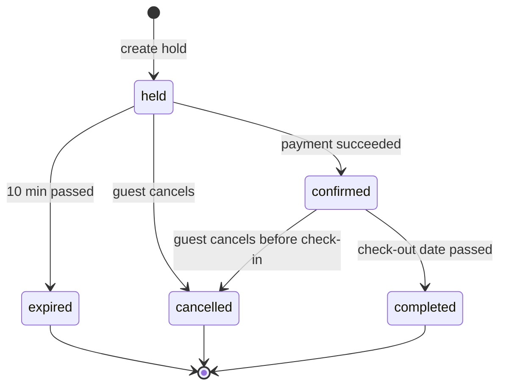

# Hajz — Business Rules

| | |
|---|---|
| Version | 0.1 (draft for review) |
| Depends on | [01-planning.md](01-planning.md), [03-data-model.md](03-data-model.md) |

Business rules are the decisions the system enforces regardless of which screen
or API call triggers them. Each rule has an ID so code, tests and error codes
can point back to it.

**Where rules are enforced (defence in depth):**

| Layer | Example |
|---|---|
| Database | `UNIQUE`, `FOREIGN KEY`, `CHECK`, `PRIMARY KEY (listing_id, night)` |
| Service (`backend/services/`) | Every rule below, raised as `AppError(code=...)` |
| Validation (`backend/validations/`) | Input shape: types, lengths, formats |
| Frontend | Same checks for fast feedback only — never trusted |

> TiDB parses `CHECK` constraints but only enforces them when
> `tidb_enable_check_constraint` is ON. MySQL 8 enforces them by default. This is
> why every rule is also enforced in the service layer.

---

## 1. Accounts (BR-ACC)

| ID | Rule | Error code |
|---|---|---|
| BR-ACC-01 | Email is unique, case-insensitive, stored lower-cased | `EMAIL_TAKEN` |
| BR-ACC-02 | Password: 10–128 characters | `WEAK_PASSWORD` |
| BR-ACC-03 | Registration requires a valid Turnstile token | `CAPTCHA_FAILED` |
| BR-ACC-04 | Unverified users can browse, save and chat, but **cannot book** | `EMAIL_NOT_VERIFIED` |
| BR-ACC-05 | Verification link: valid 24 h, single use | `TOKEN_INVALID` |
| BR-ACC-06 | Reset link: valid 1 h, single use; a successful reset revokes all refresh tokens | `TOKEN_INVALID` |
| BR-ACC-07 | 5 failed logins for one email within 15 min → blocked for 15 min | `TOO_MANY_ATTEMPTS` |
| BR-ACC-08 | Login errors never reveal whether the email exists | `INVALID_CREDENTIALS` |
| BR-ACC-09 | Access token lives 15 min; refresh token 30 days, rotated on every use | — |
| BR-ACC-10 | Reusing a revoked refresh token revokes its whole token family | `TOKEN_REUSED` |
| BR-ACC-11 | Demo personas cannot change email or password, or delete the account | `DEMO_READ_ONLY` |
| BR-ACC-12 | An account with upcoming confirmed bookings cannot be deleted until they are cancelled | `ACTIVE_BOOKINGS_EXIST` |
| BR-ACC-13 | Deleting an account anonymises its bookings and reviews, and deletes tokens, wishlist, interactions and chats | — |
| BR-ACC-14 | Admin accounts are created only from the command line, never through the API | — |

## 2. Search and catalogue (BR-CAT)

| ID | Rule | Error code |
|---|---|---|
| BR-CAT-01 | Only `is_active` listings appear anywhere | — |
| BR-CAT-02 | Dates are given together or not at all; `check_out > check_in` | `INVALID_DATES` |
| BR-CAT-03 | When dates are given, only listings available for **every** night are returned | — |
| BR-CAT-04 | Price filters apply to the nightly USD price | — |
| BR-CAT-05 | Page size: default 20, max 50 | `INVALID_PAGINATION` |
| BR-CAT-06 | Map queries return at most 500 pins; zoom in for more | — |
| BR-CAT-07 | Default sort is "recommended" (personal if logged in, else popularity) | — |

## 3. Availability (BR-AVL)

A night is **unavailable** when any of these is true:

| ID | Rule |
|---|---|
| BR-AVL-01 | It falls inside a `listing_blocks` range (`start_date ≤ night < end_date`) |
| BR-AVL-02 | It belongs to a booking that is `confirmed` or `completed` |
| BR-AVL-03 | It belongs to a `held` booking whose `hold_expires_at` is in the future |

A `held` booking whose hold has passed counts as **expired** even before any job
updates its status (lazy expiry).

## 4. Booking (BR-BKG)

### 4.1 Creating a hold

| ID | Rule | Error code |
|---|---|---|
| BR-BKG-01 | Must be logged in and verified | `AUTH_REQUIRED` / `EMAIL_NOT_VERIFIED` |
| BR-BKG-02 | `check_in` is today or later, in the **property's** time zone | `CHECK_IN_IN_PAST` |
| BR-BKG-03 | `check_in` is at most 365 days ahead | `TOO_FAR_AHEAD` |
| BR-BKG-04 | Nights ≥ listing `min_nights` | `STAY_TOO_SHORT` |
| BR-BKG-05 | Nights ≤ listing `max_nights` and ≤ 30 (platform cap) | `STAY_TOO_LONG` |
| BR-BKG-06 | 1 ≤ guests ≤ listing `accommodates` | `TOO_MANY_GUESTS` |
| BR-BKG-07 | Every night is available (section 3) | `DATES_UNAVAILABLE` |
| BR-BKG-08 | A user can have at most 3 active holds | `TOO_MANY_HOLDS` |
| BR-BKG-09 | A hold lasts 10 minutes | — |
| BR-BKG-10 | Prices are locked into the booking at hold time | — |
| BR-BKG-11 | The `booking_nights` primary key is the final guard: an overlapping insert fails and is reported as `DATES_UNAVAILABLE` | `DATES_UNAVAILABLE` |

### 4.2 Price calculation

All amounts in USD, each line rounded half-up to 2 decimals.

```text
subtotal        = nightly_price × nights
discount        = subtotal × 10 %   if nights ≥ 7  (weekly)
                  subtotal × 20 %   if nights ≥ 28 (monthly, replaces weekly)
cleaning_fee    = listing.cleaning_fee_usd (once per stay)
taxable         = subtotal − discount + cleaning_fee
service_fee     = taxable × 12 %
tax             = taxable × city.tax_rate
total           = taxable + service_fee + tax
```

**Worked example** — Tokyo, $100/night, 7 nights, cleaning $30, tax 10 %:

| Line | Amount |
|---|---|
| Subtotal 7 × $100 | $700.00 |
| Weekly discount 10 % | −$70.00 |
| Cleaning fee | $30.00 |
| Taxable | $660.00 |
| Service fee 12 % | $79.20 |
| Tax 10 % | $66.00 |
| **Total** | **$805.20** |

| ID | Rule |
|---|---|
| BR-PRC-01 | Formula above is the only source of prices; the frontend displays, never calculates |
| BR-PRC-02 | Charging is always in USD; other currencies are display-only, converted with `fx_rates` |
| BR-PRC-03 | Tax rates are simplified demo values per city, not legal tax rates |

### 4.3 Payment and confirmation

| ID | Rule | Error code |
|---|---|---|
| BR-PAY-01 | Stripe **test mode** only; the PaymentIntent amount equals `total_usd` in cents | — |
| BR-PAY-02 | A booking becomes `confirmed` only from a verified Stripe webhook (or a server-side PaymentIntent check), never from the browser's word | — |
| BR-PAY-03 | Each Stripe event is processed once (`stripe_events.event_id`) | — |
| BR-PAY-04 | Payment succeeds after the hold expired **and** the nights are still free → confirm | — |
| BR-PAY-05 | Payment succeeds after the hold expired **and** the nights were taken → booking `cancelled`, payment refunded | — |
| BR-PAY-06 | Paying for a booking that is not `held` is rejected | `BOOKING_NOT_PAYABLE` |

### 4.4 Status lifecycle



| ID | Rule | Error code |
|---|---|---|
| BR-STS-01 | Only the transitions above are allowed | `INVALID_STATUS_TRANSITION` |
| BR-STS-02 | `expired`, `cancelled` and `completed` are final | `INVALID_STATUS_TRANSITION` |
| BR-STS-03 | When a booking becomes `expired` or `cancelled`, its `booking_nights` rows are deleted, freeing the dates | — |
| BR-STS-04 | `confirmed` becomes `completed` when the property-local date is after `check_out` (applied when read, and by the nightly job) | — |
| BR-STS-05 | Only the booking owner (or an admin) can see or change a booking | `BOOKING_NOT_FOUND` (404, not 403, to avoid leaking existence) |

### 4.5 Cancellation and refunds

Time before check-in is measured to the listing's `check_in_time` in the
property's time zone.

| Policy | 100 % refund if cancelled at least | 50 % refund if at least | Otherwise |
|---|---|---|---|
| Flexible | 1 day before | — | 0 % |
| Moderate | 5 days before | 1 day before | 0 % |
| Strict | 14 days before | 7 days before | 0 % |

| ID | Rule | Error code |
|---|---|---|
| BR-CAN-01 | Cancelling a `held` booking is free (nothing was paid) | — |
| BR-CAN-02 | Refund = `total_usd × refund %`, rounded half-up | — |
| BR-CAN-03 | No cancellation on or after check-in | `CANCELLATION_CLOSED` |
| BR-CAN-04 | Refunds go back through Stripe test mode and are recorded in `payments` (`kind='refund'`) | — |

**Example:** $805.20 strict booking cancelled 9 days before check-in → 50 % →
refund **$402.60**.

## 5. Reviews (BR-REV)

| ID | Rule | Error code |
|---|---|---|
| BR-REV-01 | Only the guest of a `completed` booking can review it | `REVIEW_NOT_ALLOWED` |
| BR-REV-02 | One review per booking | `ALREADY_REVIEWED` |
| BR-REV-03 | Must be written within 30 days after check-out | `REVIEW_WINDOW_CLOSED` |
| BR-REV-04 | Rating is a whole number 1–5; comment 20–2,000 characters | `INVALID_REVIEW` |
| BR-REV-05 | A new review updates the listing rating: `new = (old × count + rating) / (count + 1)` | — |

## 6. Wishlist (BR-WSH)

| ID | Rule | Error code |
|---|---|---|
| BR-WSH-01 | Saving an already-saved stay succeeds without a duplicate (idempotent) | — |
| BR-WSH-02 | At most 200 saved stays per user | `WISHLIST_FULL` |
| BR-WSH-03 | Only active listings can be saved | `LISTING_NOT_FOUND` |

## 7. Interactions and recommendations (BR-REC)

| ID | Rule |
|---|---|
| BR-REC-01 | Signal weights: view 1, save 3, book 5, review 5, imported stay 5 |
| BR-REC-02 | A view is recorded at most once per user per listing per 30 min |
| BR-REC-03 | Recommendations never include the listing being viewed, inactive listings, or (for "for you") stays the user already booked |
| BR-REC-04 | At most 3 results from the same neighbourhood in any top-10 list |
| BR-REC-05 | Users with fewer than 3 interactions get popularity-based results for their city of interest |
| BR-REC-06 | When dates or budget are known, recommendations are filtered live by availability and price |
| BR-REC-07 | The API serves the latest **successful** ML run only |

## 8. AI assistant (BR-AI)

| ID | Rule | Error code |
|---|---|---|
| BR-AI-01 | Daily messages: visitor 5 per IP, guest 30, demo persona 30 | `AI_QUOTA_EXCEEDED` |
| BR-AI-02 | A message is at most 500 characters | `MESSAGE_TOO_LONG` |
| BR-AI-03 | A session holds at most 20 turns; older turns are dropped from context | — |
| BR-AI-04 | Every stay mentioned must come from a tool result; unknown IDs are removed before replying | — |
| BR-AI-05 | Tools are read-only; the assistant can never book, pay or change data | — |
| BR-AI-06 | Off-topic requests receive a polite refusal | — |
| BR-AI-07 | If Gemini fails or the quota is used up, the user gets standard search results instead of an error | — |

## 9. Demo personas (BR-DEMO)

| ID | Rule |
|---|---|
| BR-DEMO-01 | Personas log in with one click, without a password |
| BR-DEMO-02 | Bookings made by personas use Stripe test mode like everyone else |
| BR-DEMO-03 | Every night, persona bookings, wishlists and chats are reset to their seed state |

## 10. Data import (BR-IMP)

Applied by `ml/ingest` when loading Inside Airbnb data.

| ID | Rule |
|---|---|
| BR-IMP-01 | Keep listings with: a title, valid coordinates, `accommodates ≥ 1`, at least 1 review, and a price between $10 and $2,000 per night after conversion |
| BR-IMP-02 | Drop listings with `min_nights > 30` (many New York listings have 30-night minimums by law) |
| BR-IMP-03 | Per city, keep the top 500 by review count |
| BR-IMP-04 | `max_nights` is capped at 30 |
| BR-IMP-05 | Cancellation policy (not in the dataset) is assigned deterministically from the listing id: 50 % flexible, 30 % moderate, 20 % strict |
| BR-IMP-06 | Cleaning fee (not in the dataset): entire home 15 % of nightly price ($10–$80); private / hotel room 8 % ($5–$30); shared room $0 |
| BR-IMP-07 | Check-in 15:00, check-out 11:00 unless the dataset says otherwise |
| BR-IMP-08 | Unavailable dates in `calendar.csv` become `listing_blocks` ranges |
| BR-IMP-09 | Reviews: store the latest 30 per listing for display, reviewer first name only; use all reviews as `imported_stay` interactions |
| BR-IMP-10 | Re-running the import updates existing rows by `source_*_id`; it never creates duplicates |

Synthetic values (BR-IMP-05, -06, -07) are disclosed in the README.
